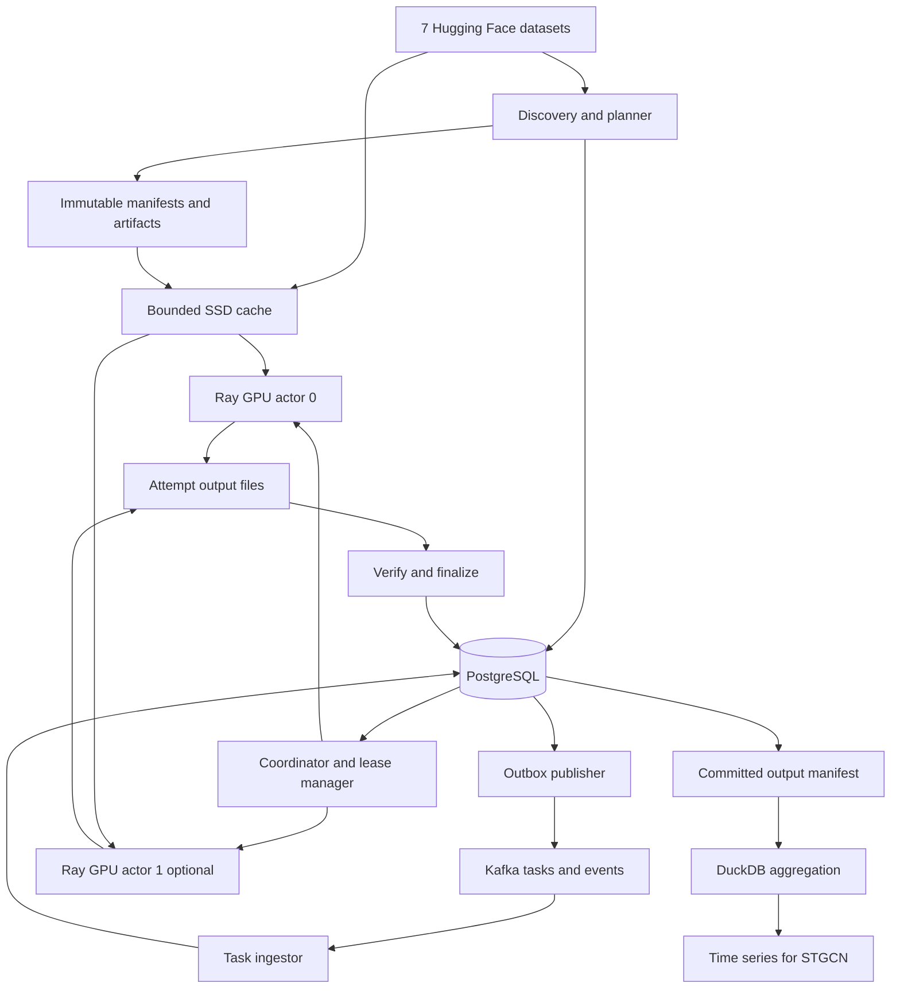

# Kafka and Ray GPU Batch Inference Pipeline for Traffic Vehicle Counting

Thiết kế triển khai độc lập cho agent ở repository mới. Mục tiêu là xử lý khoảng hai triệu ảnh từ bảy dataset, đếm xe trong ROI đã duyệt và xuất time series. Hệ thống bắt đầu với một GPU, hỗ trợ thêm GPU mà không đổi định dạng dữ liệu hoặc quy tắc đếm.

Kafka chuyển task và sự kiện; Ray quản lý tiến trình GPU; PostgreSQL giữ trạng thái công việc; Hugging Face hoặc object storage giữ ảnh và kết quả. Kafka không vận chuyển bytes ảnh và không tự tăng tốc tính toán YOLO.

## Bối cảnh và mục tiêu

| Nội dung | Yêu cầu |
| --- | --- |
| Quy mô | Khoảng 2 triệu ảnh, 7 dataset; discovery phải đếm lại thực tế |
| Camera | 28 camera giao thông Thành phố Hồ Chí Minh |
| Nhịp dữ liệu | Nguồn CCTV khoảng 12 giây một ảnh, crawler khoảng 13 giây; các camera không đồng bộ tuyệt đối |
| Model | YOLOv8s detection đã fine tune, file `best.pt` |
| ROI | JSON ROI đã duyệt, polygon chuẩn hóa theo từng camera |
| GPU ban đầu | 1 GPU; T4 có thể dùng để benchmark, L4 là cấu hình thuê ưu tiên khảo sát |
| Thời hạn | Hoàn tất trong khoảng một tuần, dành khoảng 5 ngày cho inference |
| Kết quả | Một dòng cho mỗi ảnh nguồn: camera, thời gian, từng class, tổng xe, trạng thái |
| Công việc sau đó | Aggregate thành tensor thời gian và camera cho STGCN |

Các repo đã được nêu rõ:

```text
ericng17/hcm_traffic_snapshots
ericng17/hcm_traffic_snapshots2
ericng17/hcm_traffic_snapshots3
ericng17/hcm_traffic_snapshots4
ericng17/hcm_traffic_snapshots5
```

Người dùng xác nhận hiện có bảy dataset nhưng chưa cung cấp ID hai repo bổ sung. Agent phải xác minh đủ bảy ID qua tài khoản Hugging Face hoặc yêu cầu bổ sung khi cần. Không tự coi các tên có hậu tố `6`, `7` là repo đã tồn tại.

Một lượt validation trên 1.061 ảnh đã có trên đĩa hoàn thành khoảng 25 giây theo log được cung cấp. Đây không phải throughput của pipeline đọc toàn bộ Hugging Face, lọc ROI và lưu kết quả. Không dùng số này làm cam kết thời gian sản xuất.

## Cấu hình detector đã chọn

```yaml
detector:
  family: yolov8s
  task: detect
  weights_uri: REQUIRED
  weights_sha256: REQUIRED
  imgsz: 640
  confidence: 0.35
  nms_iou: 0.70
  max_det: 1000
  classes: [0, 1, 2, 3]
  agnostic_nms: false
  augment: false
  backend: pytorch
  precision: fp32
  batch_size: 16
  allow_cpu_fallback: false
```

Mapping bắt buộc kiểm tra từ weights trước khi chạy:

| Class ID | Tên trong model | Cột kết quả |
| --- | --- | --- |
| 0 | `2-wheel vehicles` | `count_2wheel` |
| 1 | `bus` | `count_bus` |
| 2 | `car` | `count_car` |
| 3 | `truck` | `count_truck` |

Confidence 0,35 là điểm khởi đầu từ validation hiện có: precision micro 0,8522; recall micro 0,8483; MAE tổng xe 2,0330 xe/ảnh. Validation đó đếm toàn ảnh và đã có bằng chứng nhãn thiếu, nên các số này không chứng nhận sai số thực tế trong ROI của 28 camera.

MVP dùng PyTorch FP32 để kiểm chứng hành vi. Sau đó benchmark PyTorch FP16 và TensorRT FP16. Chỉ dùng profile nhanh hơn sau khi so lại số đếm, phát hiện và sai khác ở confidence 0,35. Mỗi backend hoặc precision mới có cấu hình run riêng. TensorRT engine phải build và kiểm tra cho GPU đích; không coi engine là artifact dùng chung cho mọi GPU.

## Artifacts cần chuyển sang repo mới

| Artifact | Nguồn trong dự án hiện tại | Cách dùng trong repo mới |
| --- | --- | --- |
| Weights | Google Drive `MyDrive/tfp/yolo-training/yolov8s-v20-640-run1/weights/best.pt` | Copy vào vị trí cấu hình hoặc bucket artifacts, tính và kiểm tra SHA256 |
| ROI đã duyệt | `configs/camera_rois.reviewed.json` | Copy nguyên file, không tự tạo lại polygon từ hình hoặc mô tả |
| Quy tắc inference tham chiếu | `scripts/infer_yolo_roi.py` | Có thể port các hàm kiểm tra ROI và đếm; không dùng nguyên cơ chế chia hash dòng Parquet để mở rộng GPU |
| Kết quả train và sweep | `reports/yolov8s-v20-640-run1/` và thư mục `confidence_sweep` trên Drive | Dùng đối chiếu cấu hình và kiểm chứng, không cần để worker chạy production |

Đường dẫn ở bảng là nơi lấy artifact, không phải dependency đường dẫn tuyệt đối cho hệ thống mới. Agent có thể hoàn thành code và local tests trước khi nhận đủ artifacts; GPU smoke test phải dùng file thật.

ROI hiện tại dùng schema version 1, `review_status="approved"`, `missing_cameras=[]`, và `count_rule="bottom_center_inside_or_on_boundary_of_polygon_union"`. `cameras` là list; mỗi camera có `camera_id`, `review_status`, `reference_size=[width,height]`, `regions`; mỗi region có `region_id` và `points_normalized`, là list các cặp `[x,y]`.

`points_px` và `reference_image` có thể có trong file nhưng inference dùng `points_normalized` với kích thước ảnh thực. Geometry không được tự điều chỉnh theo tên đường, góc camera hoặc class. Bộ ROI đầy đủ phải có đủ camera được manifest sử dụng; mapping tên camera của dataset sang ID ROI là artifact riêng được kiểm tra.

## Thành phần và trách nhiệm

| Thành phần | Trách nhiệm | Không chịu trách nhiệm |
| --- | --- | --- |
| Hugging Face hoặc bucket nguồn | Lưu ảnh và shard bất biến theo revision | Điều phối GPU |
| Discovery và planner | Xác định format, tạo manifest, chia task, pin nguồn và artifact | Chạy model |
| Kafka | Chuyển yêu cầu, thông báo kết quả và lỗi, hỗ trợ replay | Lưu ảnh hoặc giữ trạng thái lease |
| Task ingestor | Đưa yêu cầu Kafka vào trạng thái có thể chạy trong PostgreSQL | Chờ inference hoàn tất |
| PostgreSQL | Trạng thái chuẩn của run, task, lease, output được chọn, inbox và outbox | Lưu toàn bộ bytes ảnh |
| Coordinator | Claim task và cấp việc cho Ray actor đang rảnh, thu kết quả, quản lý retry | Nạp nhiều model vào một GPU theo mặc định |
| Ray GPU actor | Giữ model, decode/preprocess, suy luận theo batch, lọc ROI, tạo output | Tự thay đổi cấu hình khoa học của run |
| Object storage hoặc volume bền vững | Lưu manifest, artifacts, Parquet kết quả và snapshot | Thay thế transaction trạng thái task |
| DuckDB và PyArrow | Verify, hợp nhất file được commit và aggregate time series | Phân phối inference |

Ray Core actors được chọn cho phiên bản đầu. Không triển khai thêm một scheduler Ray Data và một scheduler Kafka consumer cùng tranh quyền sở hữu task. Có thể thay implementation bằng Ray Data sau này nhưng vẫn phải giữ giao thức commit output và các điều kiện nghiệm thu.



## Hạ tầng triển khai

Triển khai đầu bằng Docker Compose và một Ray head trên máy GPU. Không bắt buộc Kubernetes, Spark, Kafka Connect hoặc một dịch vụ model serving.

| Profile | Cấu hình khởi đầu |
| --- | --- |
| Phát triển local | Kafka KRaft một broker, PostgreSQL, local filesystem, fake detector CPU |
| Chạy một GPU | 1 L4 24 GB hoặc GPU CUDA tương thích, 8–12 vCPU, RAM 32–64 GB, SSD cache khoảng 200 GB |
| Chạy hai GPU | 2 GPU, khoảng 16 vCPU, RAM 64 GB, SSD cache 300–500 GB; chọn máy đáp ứng tài nguyên thực tế |
| Control plane tách riêng | Một VM CPU khoảng 4 vCPU, RAM 8–16 GB, persistent SSD cho Kafka, PostgreSQL và coordinator |
| Nhiều máy GPU | Ray worker nodes trong mạng riêng; cùng control plane và storage, task phân công trước khi download |

Để tiết kiệm, Kafka, PostgreSQL và coordinator có thể cùng chạy trên máy GPU đầu tiên nếu có volume bền vững. Khi thường xuyên tắt hoặc đổi máy GPU, tách control plane sang VM CPU để không giữ máy GPU chỉ nhằm duy trì dịch vụ.

Một broker có replication factor 1 không có khả năng chịu mất broker hoặc mất volume. Profile này chấp nhận được cho đợt batch có manifest bất biến và quy trình phục hồi đã kiểm tra. Không quảng cáo đây là cấu hình HA. Nếu cần HA, thiết kế cluster tối thiểu ba broker, replication factor 3, `min.insync.replicas=2`, PostgreSQL có phương án failover và backup tương ứng.

Kafka listeners, Ray head và PostgreSQL chỉ truy cập qua mạng riêng hoặc tunnel. Khi cần kết nối qua mạng không tin cậy, cấu hình xác thực và mã hóa; không mở trực tiếp các cổng quản trị ra Internet. Dùng persistent volume độc lập với vòng đời container và tài liệu rõ dữ liệu nào còn khi stop hoặc terminate máy.

Ảnh đã nằm trên Hugging Face có thể dùng trực tiếp. Không bắt buộc sao chép toàn bộ sang bucket mới. Chỉ chuyển nguồn sang object storage cùng region với compute nếu benchmark hoặc nhu cầu chạy lại nhiều lần cho thấy có lợi. Thời gian và chi phí chuyển nguồn phải được tính riêng.

SSD là cache cuốn chiếu. Ví dụ 2 triệu ảnh trung bình 200 kB tương đương khoảng 400 GB ảnh nén; cache 200 GB không chứa toàn bộ lượng này. Kích thước ảnh thực tế phải được đo, không lấy ví dụ này làm dung lượng dataset đã xác minh.

## Discovery và manifest

Discovery phải thực hiện trước khi giữ máy GPU chạy dài:

1. Kiểm tra quyền đọc đủ bảy repo và lấy commit revision bất biến.
2. Phân loại từng repo: ảnh raw, Parquet có embedded image bytes, hay metadata có đường dẫn tới ảnh.
3. Nếu có nhiều representation của cùng dữ liệu, chọn một nguồn chuẩn trong cấu hình; không cộng raw và Parquet như hai tập ảnh độc lập.
4. Ghi số ảnh, tổng bytes, kích thước và format ảnh, phân bố camera, khoảng timestamp và dữ liệu thiếu.
5. Xác minh ID camera trong manifest khớp bộ ROI; lưu camera mapping được duyệt nếu cách đặt tên khác nhau.
6. Tạo manifest theo shard, có checksum và URI. Ghi lại thời gian listing, đọc metadata và tải dữ liệu trong discovery.

Không nạp hai triệu ảnh hoặc toàn bộ bảng bytes ảnh vào RAM. Với Parquet, đọc metadata và row groups có giới hạn. Nếu metadata không đủ để đếm hoặc xác định camera, thực hiện một lượt scan và ghi chi phí đó vào báo cáo chuẩn bị.

Schema mỗi observation trong manifest:

| Trường | Ý nghĩa |
| --- | --- |
| `source_image_id` | SHA256 của canonical JSON `[repo_id, revision, source_path, row_index]` |
| `repo_id`, `revision` | Nguồn bất biến |
| `source_path` | File ảnh raw hoặc file Parquet gốc |
| `row_index` | Chỉ số dòng toàn file đối với Parquet; null đối với raw |
| `camera_id` | ID camera chuẩn sau mapping |
| `observed_at` | Timestamp ảnh, timezone aware, chuyển UTC |
| `timestamp_origin` | Trường metadata hoặc quy tắc parse tên file đã dùng |
| `ingested_at` | Thời điểm thu thập nếu nguồn có; không thay thế `observed_at` |
| `image_uri` hoặc `shard_uri` | Tham chiếu dữ liệu, không chứa token |
| `expected_bytes`, `source_checksum` | Khi có thể xác định |

Giữ nguyên `source_image_id` khi repack ảnh sang TAR hoặc Parquet mới; không tạo ID mới chỉ vì ảnh đổi vị trí lưu.

Các bản ghi cùng camera và timestamp nhưng khác content phải được báo là conflict. Không tự xóa hoặc chọn một ảnh khi chưa có chính sách. Ảnh giống bytes ở các timestamp khác nhau vẫn là các observation khác nhau. Cache dự đoán theo content là tối ưu tùy chọn; không được làm mất các dòng thời gian.

## Chia task và batch GPU

Task là đơn vị phân công và retry; batch GPU là nhóm ảnh được suy luận cùng lúc. Hai khái niệm này phải tách biệt.

Planner tạo `task_id` từ canonical JSON của `run_id`, `spec_hash` và descriptor shard bất biến, gồm manifest checksum cùng phạm vi observation. Chạy lại planner với cùng input phải tạo đúng cùng task IDs và không tạo thêm outbox yêu cầu mới cho task đã tồn tại.

| Mức | Giá trị khởi đầu |
| --- | --- |
| Task | Một shard độc lập; mục tiêu khoảng 256 MB–1 GB hoặc 2.000–5.000 ảnh, điều chỉnh theo dữ liệu |
| Batch GPU | Bắt đầu 16; benchmark 16, 32, 64 khi đủ VRAM |
| Model actor | Một actor cho mỗi GPU; nạp model một lần |
| Task đang chạy | Tối đa một task mỗi actor |
| Prefetch | Tối đa 1–2 shard tiếp theo cho mỗi actor, chịu giới hạn byte toàn node |
| Decoded buffer | Tối đa 2–4 batch, không decode cả shard vào RAM |

Nếu input đã là các file Parquet vừa phải, mỗi file là một task. Không để mọi GPU tải cùng Parquet rồi lọc những dòng khác nhau bằng hash. Với file lớn, dùng cache dùng chung trên một node hoặc repack thành shard vật lý nhỏ hơn; phải benchmark lợi ích so với thời gian repack.

Nhiều task có thể thuộc cùng repo. Actor nào rảnh nhận task tiếp theo; không gán cứng một repo cho một GPU. Phân công diễn ra trước download. Retry sau lỗi có thể phải tải lại dữ liệu, nhưng hai attempt hợp lệ không được cùng claim một task.

SSD cache cần khóa theo checksum hoặc `(repo, revision, source_path)`, tải vào file tạm rồi rename sau khi hoàn thành. Không evict file đang được worker sử dụng. Có giới hạn byte, cơ chế LRU và backpressure khi gần đầy.

## Kafka topics và giao thức message

Kafka chỉ truyền thông tin tham chiếu, thường vài kB mỗi message. Không gửi JPEG, base64 ảnh, tensor hoặc mọi bounding box qua Kafka.

| Topic | Nội dung | Partitions khởi đầu | Retention đề xuất |
| --- | --- | --- | --- |
| `traffic.inference.tasks.v1` | Yêu cầu kích hoạt task đã lập kế hoạch | 16 | 14 ngày |
| `traffic.inference.events.v1` | Tiến độ và thay đổi trạng thái | 16 | 30 ngày |
| `traffic.inference.results.v1` | URI output đã commit, row count, checksum | 16 | 30 ngày |
| `traffic.inference.dlq.v1` | Message sai hoặc task lỗi cuối cùng | 4 | 30 ngày |

Dùng cleanup policy `delete` cho log sự kiện trong MVP. Khóa task và result message bằng `task_id`; mọi message có `event_id` duy nhất. Snapshot trạng thái chuẩn đọc từ PostgreSQL, không suy ra từ một event có thể đến trễ.

Ví dụ payload task; chuỗi trong dấu ngoặc nhọn là placeholder:

```json
{
  "schema_version": 1,
  "event_id": "{stable_event_id}",
  "event_type": "task.requested",
  "run_id": "{run_id}",
  "task_id": "{task_id}",
  "spec_hash": "{spec_hash}",
  "manifest_uri": "s3://{bucket}/manifests/{manifest_hash}/part-000001.parquet",
  "manifest_sha256": "{sha256}",
  "expected_images": 4000,
  "created_at": "2026-11-21T12:00:00Z"
}
```

Không đưa credentials hoặc URL chứa token ký sẵn vào metadata bền vững. Worker resolve URI bằng credentials môi trường.

Producer dùng `enable.idempotence=true`, `acks=all`; outbox publisher chỉ đánh dấu publish thành công khi nhận delivery acknowledgement. Thiết lập này không biến ghi output vào object storage thành transaction Kafka.

Task được ghim theo manifest trong database; ingestor đối chiếu `task_id`, `spec_hash`, manifest hash và expected count với bản ghi planner. Payload lệch không được thay đổi descriptor của task đã có. Message không parse được được lưu digest và metadata nguồn vào inbox lỗi, kèm outbox DLQ trong transaction rồi mới commit offset.

Consumer nhận task dùng `confluent-kafka` với:

```python
{
    'group.id': 'traffic-task-ingestor-v1',
    'enable.auto.commit': False,
    'enable.auto.offset.store': False,
    'auto.offset.reset': 'earliest',
    'max.poll.interval.ms': 300000,
}
```

Consumer xử lý từng message theo thứ tự của partition: validate, ghi inbox và trạng thái task trong một transaction PostgreSQL, rồi commit offset message đó bằng synchronous commit. Sau crash có thể đọc lại; event ID và trạng thái task ngăn kích hoạt lại task đã hoàn thành. Không gọi `ray.get()` hoặc chạy inference trong vòng `poll()`.

Đây là thiết kế chuyển giao ít nhất một lần, kết hợp ghi output có kiểm soát trùng. Không tuyên bố exactly once cho cả Kafka, PostgreSQL và object storage. Các nguồn chính thức mô tả giới hạn này tại [Kafka delivery semantics](https://kafka.apache.org/41/design/design/) và [Confluent Python client](https://docs.confluent.io/kafka-clients/python/2.16/overview.html).

## Trạng thái PostgreSQL và outbox

PostgreSQL là nơi quyết định task nào cần chạy và file nào được tính vào kết quả. Tối thiểu có các bảng:

| Bảng | Khóa và nội dung bắt buộc |
| --- | --- |
| `runs` | `run_id` primary key; spec hash, cấu hình bất biến, manifest hash, trạng thái, expected count |
| `tasks` | Unique `(run_id, task_id)`; trạng thái, manifest reference, số ảnh, attempt count, available time, lease token, owner, expiry, output được chọn |
| `task_attempts` | Unique `(run_id, task_id, attempt_id)`; worker, môi trường, thời gian, lỗi, candidate output, metrics |
| `inbox_messages` | Unique `(kafka_log_generation, topic, partition, offset)`; unique event ID đối với message hợp lệ, digest, kết quả xử lý |
| `outbox_events` | `event_id` unique; payload, thời điểm tạo, delivery acknowledgement, retry count |
| `committed_outputs` | Unique `(run_id, task_id)`; URI attempt được chọn, checksum, row count, success/error counts |

Chu trình trạng thái task:

```text
PLANNED -> QUEUED -> RUNNING -> SUCCEEDED
                        |
                        +-> RETRY_WAIT -> RUNNING
                        |
                        +-> FAILED
```

Planner tạo `PLANNED` và outbox `task.requested` trong cùng transaction. Ingestor nhận event qua Kafka mới chuyển `PLANNED` thành `QUEUED`. Message lặp không được reset task đang chạy hoặc đã thành công.

Coordinator claim task đến hạn bằng transaction ngắn với row locking và `FOR UPDATE SKIP LOCKED`, tăng attempt count, tạo `attempt_id` và lease token mới. Không giữ transaction mở trong khi suy luận. SQL này dùng cho phân công kiểu queue, không phải một truy vấn snapshot dùng cho phân tích. [PostgreSQL row locking](https://www.postgresql.org/docs/17/sql-select.html)

Giá trị khởi đầu: heartbeat 30 giây, lease TTL 180 giây, task deadline 30 phút, tối đa 3 attempts; backoff sau attempt lỗi lần lượt 30 và 120 giây. Điều chỉnh task deadline theo p95 benchmark. Heartbeat chỉ được gia hạn khi token hiện tại còn hợp lệ; task có deadline hữu hạn kể cả khi heartbeat vẫn chạy.

Mỗi thay đổi trạng thái cần có `state_version` tăng đơn điệu và outbox event trong cùng transaction. Event bị gửi lặp có cùng `event_id`; projector hoặc downstream consumer deduplicate theo ID và không áp dụng snapshot có state version cũ.

## Chạy Ray và quản lý GPU

Coordinator tạo số actor theo số GPU được cấu hình và tài nguyên thực tế. Mỗi actor yêu cầu một GPU bằng cơ chế resource của Ray, xác nhận CUDA và chỉ dùng device được cấp. Worker không tự chuyển sang CPU khi GPU không sẵn sàng.

Actor nạp weights và ROI một lần, xác minh checksum và mapping, chạy warmup, sau đó nhận lần lượt các task. Không truyền cả shard ảnh hoặc tensor lớn qua Ray object store; truyền manifest reference hoặc cache path. Giới hạn CPU/RAM cho downloader và decoder để chúng không chiếm hết tài nguyên của actor.

Ở MVP, PostgreSQL điều khiển retry task. Tắt retry tự động cho method xử lý task của Ray để không tạo thêm các attempt ẩn ngoài lease protocol. Khi actor chết, coordinator tái tạo actor, còn task được thu hồi theo lease/deadline. Ray head mất không làm mất các task đã được lưu trong PostgreSQL.

Có thể benchmark DALI/nvJPEG để decode và resize trên GPU. Tắt tự xoay theo EXIF và giữ đúng RGB, padding, letterbox cùng phép biến đổi tọa độ. Chỉ kích hoạt sau khi kiểm thử parity với pipeline PyTorch ban đầu. Thêm GPU không có nghĩa được đọc lại toàn bộ manifest hoặc tải lặp mọi shard.

TensorRT phải nhận được batch cuối nhỏ hơn batch tối đa bằng optimization profile dynamic phù hợp, hoặc padding batch rồi loại các kết quả padding trước khi ghi observation. Không bỏ batch cuối; không ghi dòng cho ảnh padding. Khóa NMS và preprocessing theo profile đã kiểm thử, không đồng thời áp dụng NMS tích hợp và một NMS ngoài không tương thích.

Ray cung cấp actor/resource scheduling cho batch inference; cách quản lý lease và commit trong tài liệu này do ứng dụng thực hiện. [Ray batch inference](https://docs.ray.io/en/latest/data/batch-inference.html)

## Quy tắc ROI và số đếm

1. ROI chung và từng camera phải được duyệt; polygon hợp lệ, có tối thiểu ba đỉnh, tọa độ chuẩn hóa.
2. Decode ảnh theo hướng gốc, không tự xoay EXIF. Kiểm tra aspect ratio với ảnh tham chiếu; sai lệch quá 1% làm task lỗi có mã rõ ràng. Không tự crop hoặc sửa ROI.
3. YOLO dự đoán trên ảnh đầy đủ. Đưa box về tọa độ ảnh gốc trước khi xét ROI.
4. Điểm đại diện box là giữa cạnh đáy: `((x1 + x2) / 2, y2)`.
5. Điểm nằm trong hoặc trên biên bất kỳ polygon nào của camera được tính; polygon được hợp về mặt logic để mỗi detection chỉ tính một lần.
6. Đếm class 0–3 sau class-aware NMS và confidence filtering. `total_vehicles` bằng tổng bốn cột class.
7. Camera không có ROI hoặc mapping không rõ phải được phát hiện sớm, không fallback sang đếm toàn ảnh.
8. Ảnh đọc được nhưng không phát hiện xe có status `ok` và số đếm 0. Ảnh hỏng có status `error`, các số đếm null, có error code; không biến ảnh hỏng thành 0 xe.
9. Ghi cảnh báo khi số detection chạm `max_det`, để nhận biết khả năng kết quả bị cắt.

ROI hash và camera mapping hash là thành phần của run spec. Không đổi ROI trong một run đã bắt đầu.

## Ghi kết quả và chống ghi trùng

Mỗi task ghi một file Parquet theo attempt, không để nhiều GPU ghi chung một CSV hoặc SQLite. Định dạng output tối thiểu:

| Trường | Kiểu hoặc quy tắc |
| --- | --- |
| `run_id`, `spec_hash`, `task_id`, `attempt_id` | String |
| `source_image_id` | String, unique trong một run được materialize |
| `camera_id` | String |
| `observed_at` | Arrow timestamp có timezone UTC |
| `repo_id`, `revision`, `source_path`, `row_index` | Giữ truy vết ảnh nguồn |
| `image_sha256` | SHA256 bytes ảnh đã đọc; null khi không có bytes |
| `count_2wheel`, `count_bus`, `count_car`, `count_truck` | Nullable integer, không âm |
| `total_vehicles` | Nullable integer, bằng tổng class đối với status ok |
| `status`, `error_code` | `ok` hoặc `error`; lỗi có mã máy đọc được |
| `processed_at`, `weights_sha256`, `roi_sha256` | Thời gian UTC và artifact hash |

Đường dẫn tham khảo:

```text
artifacts/models/{weights_sha256}/best.pt
artifacts/rois/{roi_sha256}/camera_rois.json
manifests/{manifest_hash}/part-*.parquet
runs/{run_id}/spec.json
runs/{run_id}/attempts/{task_id}/{attempt_id}/counts.parquet
runs/{run_id}/committed_outputs.json
runs/{run_id}/reports/summary.json
runs/{run_id}/timeseries/part-*.parquet
```

Giao thức hoàn tất task:

1. Ghi file tạm trên SSD, kiểm tra schema, unique source ID, đúng số dòng expected và checksum.
2. Upload file vào URI riêng của attempt; xác nhận upload hoàn thành và object tồn tại với đúng metadata.
3. Trong transaction PostgreSQL, khóa task và kiểm tra task còn `RUNNING`, attempt và lease token đúng, lease chưa hết hạn theo giờ database.
4. Ghi `committed_outputs`, chuyển task thành `SUCCEEDED`, lưu success/error counts và outbox result event trong cùng transaction.
5. Nếu lease không hợp lệ, không commit candidate output. File của attempt cũ trở thành orphan và có thể dọn sau.

Object storage không cần atomic rename. Chỉ file được chọn trong `committed_outputs` mới là kết quả hợp lệ. Export không glob mọi file dưới `attempts/`, vì có thể có file của retry hoặc worker hết lease.

Nếu task được giao lại sau khi đã thành công, xác minh output được chọn và bỏ qua inference. Nếu output đã commit bị mất hoặc checksum sai, đánh dấu cần phục hồi và tạo attempt mới qua state machine; không âm thầm coi run hoàn chỉnh.

Output của task hoàn thành được lưu bền vững ngay. Snapshot metadata và báo cáo toàn run được sao lưu mỗi giờ, cộng một lần khi dừng có kiểm soát. Snapshot PostgreSQL dùng công cụ backup nhất quán như `pg_dump`; không copy file database đang ghi.

Export tạo danh sách output từ một snapshot trạng thái database nhất quán, kèm số task còn thiếu; chỉ báo final sau khi tất cả task đạt trạng thái kết thúc được chấp nhận. Lưu checksum của committed output manifest. Có thể tạo bản export mới sau retry mà không ghi đè các file attempt bất biến.

Runbook phục hồi cần có các trường hợp:

- Compute node mất: tạo lại actors, reclaim lease hết hạn, giữ nguyên output đã commit.
- Kafka mất log: đối chiếu các task `PLANNED` trong PostgreSQL, tái phát `task.requested` bằng cơ chế reconcile rõ ràng; không reset task `SUCCEEDED`. Inbox key phải tính thêm định danh Kafka log generation sau recreate hoặc dùng event ID làm khóa dedupe chuẩn, để offset mới trùng offset cũ không làm mất task.
- PostgreSQL cần restore snapshot: đối chiếu manifest bất biến và storage, kiểm tra output còn thiếu theo state đã restore; có thể tính lại phần chưa được snapshot ghi nhận nhưng không materialize trùng source ID. Snapshot toàn run và output selection phải đủ để tái dựng các task đã xác minh.

`kafka_log_generation` là định danh deployment/log do operator thay khi dựng lại log Kafka rỗng. Nó được lưu cùng trạng thái control plane; event ID không đổi khi republish một yêu cầu. Không dựa riêng vào offset để nhận biết message đã xử lý qua các lần recreate broker.

## Các tình huống lỗi bắt buộc xử lý

| Tình huống | Hành vi |
| --- | --- |
| Crash trước khi ghi output | Lease hết hạn, task retry |
| Upload xong nhưng chưa commit PostgreSQL | Candidate là orphan; retry không tạo hai output được chọn |
| Commit output xong nhưng chưa publish Kafka result | Outbox publisher gửi lại sau khi phục hồi |
| Kafka đã ack nhưng outbox chưa ghi nhận ack | Có thể gửi lặp event; consumer deduplicate |
| Ingestor ghi PostgreSQL xong nhưng chưa commit Kafka offset | Đọc lại message, inbox ngăn reset task |
| Worker cũ hoàn tất sau khi task được claim lại | Lease token cũ bị từ chối khi finalize |
| Download lỗi tạm thời | Timeout và retry hữu hạn, không giữ GPU chờ vô hạn |
| Parquet hoặc URI nguồn không truy cập được sau mọi retry | Task `FAILED`, run chưa hoàn chỉnh |
| JPEG hỏng ở một observation | Ghi một error row, counts null; báo chất lượng dữ liệu |
| Không có ROI hoặc class mapping sai | Dừng xử lý cấu hình lỗi; không retry vô hạn |
| CUDA OOM | Restart actor, thử batch nhỏ hơn theo policy đã cấu hình, ghi batch thực tế; không chuyển CPU |
| Hết SSD cache | Backpressure, evict file không còn dùng; không xóa file đang đọc |
| Broker ngừng hoạt động | Task đã `QUEUED` vẫn có thể chạy; outbox chờ broker phục hồi |

Batch size có thể là tham số vận hành để giảm khi OOM; mọi thay đổi phải được log. Backend, precision, kích thước ảnh, threshold, class mapping và ROI là cấu hình dự đoán, không được thay trong cùng run.

## Run spec và khả năng tái lập

`spec_hash` tính từ canonical JSON của model hash, ROI hash, camera mapping, manifest hash, nguồn/revisions, parser timestamp, quy tắc đếm, detector settings, backend/precision và phiên bản code/dependencies ảnh hưởng dự đoán. Không hash token, local cache path hoặc URI ký tạm.

`run_id` định danh một lần chạy; không tái sử dụng cùng tên với spec khác. Resume phải kiểm tra spec và artifacts trước khi nhận task. Ghi thêm container digest, GPU model, CUDA, driver, PyTorch, Ultralytics, TensorRT nếu dùng, và batch thực tế cho mỗi attempt. Không hứa kết quả bitwise giống nhau trên mọi GPU hoặc backend.

Môi trường baseline phải tương thích checkpoint. Notebook hiện tại pin Ultralytics `8.3.253`; agent phải xác nhận import và load weights trong container rồi khóa các phiên bản phù hợp, không tự nâng tất cả package lên latest. Profile TensorRT và DALI cần matrix GPU/CUDA/dependency đã kiểm tra riêng.

## Cấu hình triển khai mẫu

Đây là template, chưa chạy được cho dữ liệu thật khi chưa điền đủ bảy repo và artifact URI/hash. Secrets lấy từ environment hoặc secret manager; không đặt trong YAML.

```yaml
run:
  id: hcm-yolov8s-roi-run1
  expected_dataset_count: 7
  deadline_hours: 168
  inference_budget_hours: 120

input:
  repo_ids: []  # Bắt buộc điền đủ 7 ID đã xác minh
  revision_policy: pin_at_plan_time
  representation: per_repo_explicit
  source_timezone: Asia/Ho_Chi_Minh
  manifest_uri: REQUIRED

artifacts:
  weights_uri: REQUIRED
  weights_sha256: REQUIRED
  roi_uri: REQUIRED
  roi_sha256: REQUIRED
  camera_mapping_uri: REQUIRED

detector:
  imgsz: 640
  confidence: 0.35
  nms_iou: 0.7
  max_det: 1000
  classes: [0, 1, 2, 3]
  backend: pytorch
  precision: fp32
  batch_size: 16
  allow_cpu_fallback: false

execution:
  gpu_actors: 1
  task_target_images: 4000
  task_target_bytes: 536870912
  prefetch_shards_per_actor: 1
  decoded_batches_per_actor: 2
  cache_max_bytes: 150000000000
  task_deadline_seconds: 1800
  lease_ttl_seconds: 180
  heartbeat_seconds: 30
  max_attempts: 3
  retry_backoff_seconds: [30, 120]

services:
  kafka_bootstrap_servers_env: KAFKA_BOOTSTRAP_SERVERS
  postgres_dsn_env: DATABASE_URL
  hf_token_env: HF_TOKEN
  object_store_endpoint_env: OBJECT_STORE_ENDPOINT
  object_store_credentials: environment

output:
  base_uri: REQUIRED
  format: parquet
  compression: zstd
  metadata_backup_interval_seconds: 3600
  preview_max_images: 56
  save_all_annotated_images: false
```

Task sizing dùng cả giới hạn bytes và ảnh để điều tiết dữ liệu. Với Parquet vật lý sẵn có, giữ ranh giới file trước; không chia row range theo cấu hình mẫu rồi bắt mọi worker download lại cả file.

## CLI và cấu trúc repository mới

Agent triển khai CLI có tên tương đương `traffic-pipeline` với các thao tác:

```text
traffic-pipeline discover --config CONFIG --output DISCOVERY_REPORT
traffic-pipeline plan --config CONFIG
traffic-pipeline publish --run-id RUN_ID
traffic-pipeline ingest
traffic-pipeline work --run-id RUN_ID --gpu-actors 1
traffic-pipeline status --run-id RUN_ID
traffic-pipeline retry --run-id RUN_ID --failed-only
traffic-pipeline reconcile --run-id RUN_ID --republish-planned
traffic-pipeline verify --run-id RUN_ID
traffic-pipeline export --run-id RUN_ID
traffic-pipeline aggregate --run-id RUN_ID --window 1min
traffic-pipeline benchmark --config CONFIG --sample-manifest SAMPLE
```

Các command không được báo thành công nếu chỉ enqueue xong mà chưa hoàn tất inference. `status` phân biệt PLANNED, QUEUED, RUNNING, RETRY_WAIT, SUCCEEDED và FAILED; thể hiện cả số task và số observation đã commit.

Cấu trúc tham khảo:

```text
configs/example.yaml
infra/compose.yaml
infra/Dockerfile.worker
infra/migrations/
src/traffic_pipeline/config.py
src/traffic_pipeline/discovery.py
src/traffic_pipeline/manifest.py
src/traffic_pipeline/planner.py
src/traffic_pipeline/kafka_ingestor.py
src/traffic_pipeline/outbox.py
src/traffic_pipeline/state.py
src/traffic_pipeline/coordinator.py
src/traffic_pipeline/gpu_actor.py
src/traffic_pipeline/roi.py
src/traffic_pipeline/cache.py
src/traffic_pipeline/storage.py
src/traffic_pipeline/finalize.py
src/traffic_pipeline/verify.py
src/traffic_pipeline/aggregate.py
src/traffic_pipeline/benchmark.py
src/traffic_pipeline/cli.py
tests/unit/
tests/integration/
tests/fixtures/
docs/RUNBOOK.md
docs/BENCHMARK.md
```

Control plane container không cần cài CUDA. Worker container có môi trường GPU đã pin. Compose cung cấp profile fake detector để kiểm tra control plane trên máy không có GPU. Images Docker phải khóa phiên bản hoặc digest khi bàn giao; không dựa vào tag `latest`.

## Quan sát hiệu năng và ngân sách

Theo dõi wall clock của cả run, discovery/listing, download bytes/s, cache hit, decode/preprocess, model/NMS, ROI, ghi/upload, DB finalize, Kafka lag, số task retry, ảnh lỗi, VRAM và GPU utilization. Timing GPU phải tính tới CUDA bất đồng bộ, dùng CUDA events hoặc synchronization đúng ở benchmark.

Throughput chính là số ảnh status `ok` đã commit bền vững trên một giây wall clock. Báo riêng số observation xử lý tổng và số error; không để lỗi decode làm throughput có vẻ cao. Không cộng các timing stage chạy chồng lấp rồi coi là thời gian thực của pipeline.

Benchmark dữ liệu đại diện cả bảy repo, nhiều camera, ngày/đêm, kích thước ảnh và mật độ xe. Có hai phép đo: cold cache có download và warm cache. Báo riêng thời gian build engine, khởi động, listing và repack nếu có.

| Throughput end to end giả định | Thời gian cho 2 triệu ảnh |
| --- | --- |
| 10 ảnh/giây | 55,6 giờ |
| 20 ảnh/giây | 27,8 giờ |
| 50 ảnh/giây | 11,1 giờ |

Các hàng trên là phép tính, không phải benchmark L4. Với tổng ảnh N và ngân sách 5 ngày, tốc độ yêu cầu là `N / 432000` ảnh/giây; khoảng 4,63 ảnh/giây nếu N đúng bằng 2 triệu. Cần cộng thời gian chuẩn bị và phục hồi ngoài ngân sách inference này.

Chạy một GPU trong 30–60 phút trên workload đại diện trước. Chỉ thuê thêm GPU khi ETA theo throughput thực tế không đủ dư địa, hoặc người dùng ưu tiên hoàn tất sớm hơn. So chi phí trên một triệu ảnh bằng `hourly_total_cost * 1000000 / (3600 * measured_images_per_second)`, gồm CPU, storage và truyền dữ liệu. Không giả định thêm G GPU sẽ tăng tốc đúng G lần.

## Verify và aggregate cho STGCN

Chỉ export từ danh sách output đã commit. Điều kiện bảo toàn là số source ID unique trong output bằng số observation trong manifest, gồm cả error rows. Mỗi source ID có đúng một dòng; không mất ảnh và không có hai attempt cùng được chọn.

Run có mọi task thành công và không có error row được đánh dấu `COMPLETED`. Nếu mọi task có output nhưng có error rows, đánh dấu `COMPLETED_WITH_ERRORS` và xuất danh sách ảnh lỗi. Có task failed hoặc thiếu output thì run chưa hoàn chỉnh; không xuất nhãn hoàn tất chỉ vì Kafka lag đã về 0.

Khi tạo time series:

- Giữ timestamp gốc và timezone; không dùng thứ tự Kafka làm thời gian quan sát.
- Đưa các camera về cùng grid 1 phút hoặc cấu hình khác, dùng cửa sổ kết thúc tại thời điểm nhãn.
- Tổng hợp số xe snapshot bằng mean hoặc median được chọn trước; không cộng thành số xe duy nhất đi qua.
- Phân biệt không có ảnh hợp lệ với ảnh hợp lệ đếm được 0 xe.
- Xuất `observation_count`, `valid_count`, missing mask và observation age; không lấy quan sát tương lai để điền quá khứ.
- Báo camera/timestamp conflict và duplicate nguồn; chính sách xử lý phải xác định trước khi aggregate.
- Chia train/validation/test theo thời gian cho STGCN, không random các cửa sổ chồng lấp.

Đây là chuỗi số xe quan sát, không tự động là nhãn kẹt xe đã được xác minh.

## Kiểm thử và điều kiện nghiệm thu

Agent phải cung cấp test cho các hành vi có rủi ro mất hoặc đếm trùng dữ liệu:

1. Schema config từ chối thiếu repo, thiếu artifact, class mapping sai hoặc resume khác spec.
2. ROI đúng biên, nhiều polygon chồng nhau, camera thiếu ROI, aspect ratio sai và ảnh có EXIF rotation.
3. Camera/timestamp parser theo format thực; không tự đổi thời gian mơ hồ thành thời điểm hiện tại.
4. Task chia trước download, coverage đủ manifest, không overlap giữa task.
5. Kafka message lặp, consumer rebalance và crash giữa DB commit với Kafka offset commit.
6. Crash trước/sau upload, trước/sau finalize; final output chỉ chọn một attempt.
7. Lease hết hạn rồi worker cũ trả kết quả; token cũ không thể ghi đè attempt mới.
8. Outbox publisher gửi lặp và outage broker; không mất task hoặc result event đã ghi bền vững.
9. Ảnh hỏng, ảnh không có xe, nguồn không truy cập được, task failed và batch cuối không đầy.
10. OOM giảm batch theo policy hữu hạn; không fallback CPU hoặc tự thay imgsz.
11. Restart toàn compute node, khôi phục từ PostgreSQL/storage; task đã commit không chạy lại không cần thiết.
12. Full run fixture có lỗi giả lập: source IDs output đủ, unique, total bằng tổng class, lỗi là null và có error code.
13. Aggregate không dùng ảnh tương lai, không cộng snapshot thành flow, phân biệt missing với zero.

Integration test local dùng fake detector và Kafka/PostgreSQL thật trong Compose. GPU smoke test là bước riêng, chạy trên tập nhỏ có model thật trước batch lớn. Test nhiều actor fake chứng minh phân công và idempotency; không dùng nó để tuyên bố hiệu năng nhiều GPU thật.

Deliverables nghiệm thu:

- Code chạy local với fake detector và một lệnh smoke test.
- GPU worker load được best.pt, ROI và chạy thành công sample thật.
- Báo cáo cold/warm benchmark, ETA, bottleneck và tài nguyên.
- Script retry và quy trình restore đã kiểm chứng.
- Schema manifest/output, migrations, example config và runbook đầy đủ.
- Không có token hardcode, signed URL bền vững, ảnh gửi Kafka hoặc SQLite dùng chung giữa GPU workers.
- Chưa thuê máy hoặc chạy đợt cloud trả phí chỉ để chứng minh scaffolding hoạt động; bàn giao cấu hình và lệnh triển khai rõ ràng trước.

## Thứ tự triển khai

1. Config, artifacts, detector interface, ROI và local shard runner với fake/real backend.
2. PostgreSQL state machine, lease/fencing, output finalization, verify và các bài test crash.
3. Kafka inbox/outbox, ingestor và replay; xác nhận không inference trong poll loop.
4. Ray một GPU, prefetch có giới hạn, metrics và smoke test dataset thật.
5. Benchmark một GPU; thử FP16/TensorRT và DALI theo kết quả profile.
6. Mở rộng nhiều actor hoặc nhiều node khi có lý do từ ETA/chi phí.
7. Full batch, verify, export và aggregate cho STGCN.

## Prompt bàn giao cho agent

```text
Triển khai Kafka and Ray GPU Batch Inference Pipeline theo tài liệu này trong repo hiện tại.

Đọc AGENTS.md và cấu trúc repo trước. Nếu repo có .codegraph thì dùng CodeGraph theo hướng dẫn repo. Không phụ thuộc đường dẫn /home/eric/personal/tfp của máy gốc.

Mục tiêu: xử lý khoảng 2 triệu ảnh từ đủ 7 Hugging Face dataset, YOLOv8s best.pt, ROI đã duyệt cho 28 camera; xuất một dòng observation với tổng xe và 4 class. Bắt đầu một GPU, hỗ trợ mở rộng.

Các quyết định bắt buộc:
- Kafka chỉ chuyển metadata task và result pointers.
- PostgreSQL là trạng thái chuẩn; inbox/outbox, lease token và finalization phải chịu được crash và giao task lặp.
- Task được chia theo shard trước download; Ray actor giữ model lâu dài, một GPU/actor.
- Source revision, weights, ROI và inference spec bất biến trong run.
- Đếm bottom-center trong hợp polygon ROI; missing ROI không được fallback toàn ảnh.
- counts của ảnh lỗi là null; ảnh ok không có xe là 0.
- Chỉ output attempt được commit mới được export; không glob toàn bộ attempt files.
- Không công bố exactly once xuyên Kafka/DB/object storage.
- Không train lại YOLO, không thay ROI hoặc threshold ngoài cấu hình, không tự thuê dịch vụ trả phí.

Trước tiên hoàn thiện local Compose + fake detector + integration tests cho idempotency và phục hồi. Tiếp theo GPU smoke test, benchmark và hướng dẫn chạy thật. Hoàn thành code, config, migrations, test, runbook; không dừng ở skeleton hoặc sơ đồ.

Xác minh đủ 7 repo IDs, đường dẫn artifacts và schema nguồn. Hai repo bổ sung chưa được xác nhận trong tài liệu; không tự bịa tên. Phần thiếu thông tin nguồn không ngăn triển khai và kiểm thử local bằng fixture.
```

## Tài liệu tham khảo

- [Apache Kafka delivery semantics](https://kafka.apache.org/41/design/design/)
- [Confluent Python client và offset management](https://docs.confluent.io/kafka-clients/python/2.16/overview.html)
- [Confluent Python API](https://docs.confluent.io/platform/current/clients/confluent-kafka-python/html/index.html)
- [Ray batch inference](https://docs.ray.io/en/latest/data/batch-inference.html)
- [PostgreSQL SELECT và row locking](https://www.postgresql.org/docs/17/sql-select.html)
- [Hugging Face WebDataset](https://huggingface.co/docs/hub/en/datasets-webdataset)
- [Ultralytics TensorRT export](https://docs.ultralytics.com/integrations/tensorrt/)
- [NVIDIA DALI image decoder](https://docs.nvidia.com/deeplearning/dali/user-guide/docs/operations/nvidia.dali.fn.decoders.image.html)

Khi triển khai, khóa các version tương thích đã kiểm tra. Ví dụ API trong tài liệu vendor mới nhất có thể khác API của Ultralytics 8.3.253 đang dùng cho checkpoint.
